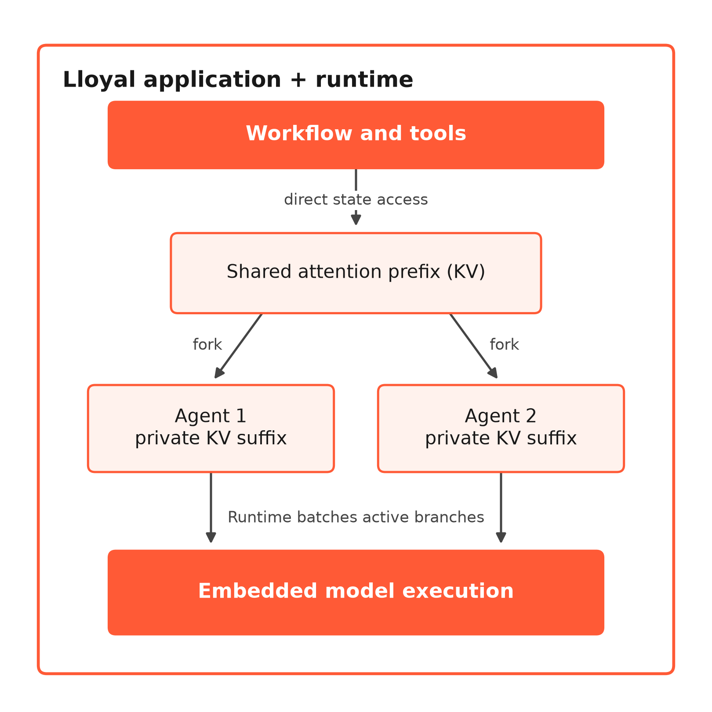
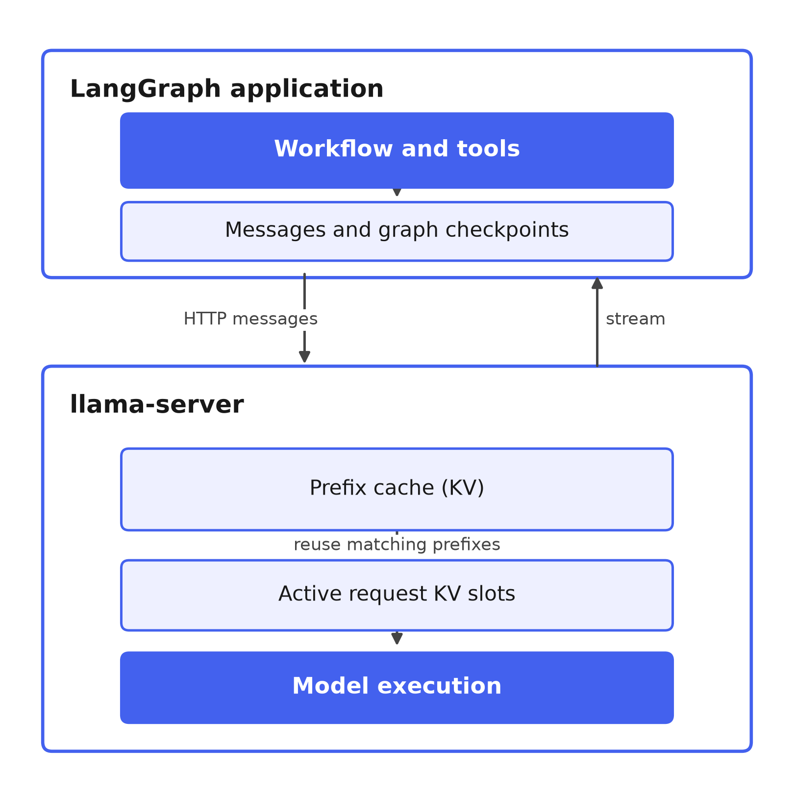
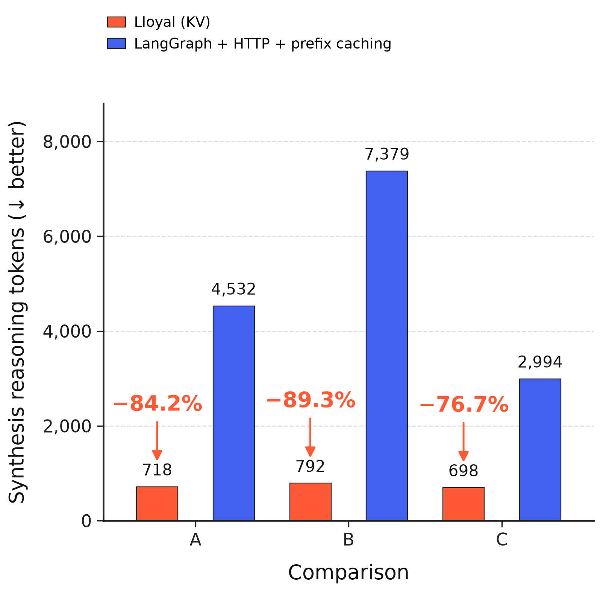
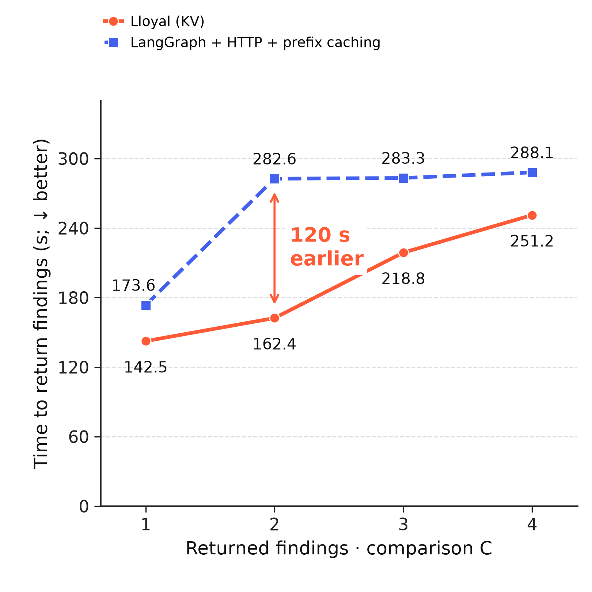
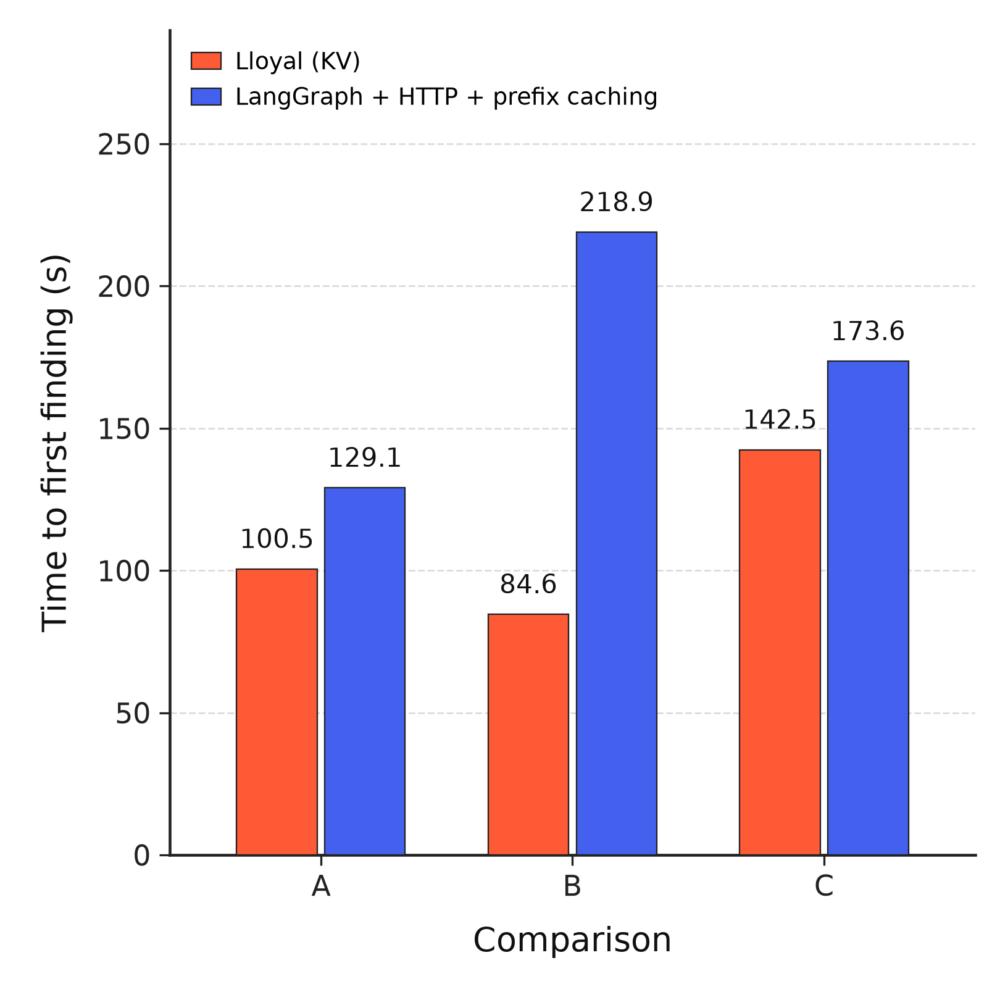
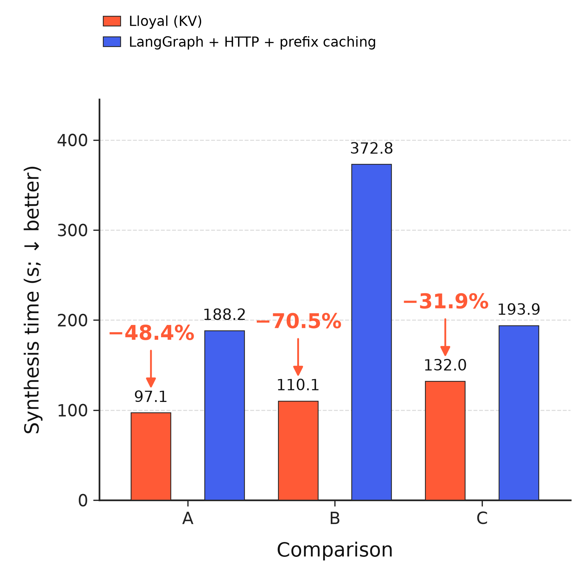

## Less deliberation in agent workflows

The comparison starts at **4B parameters**, with the model, vision projector and reranker running on **16 GB of unified memory**.

Fieldnote, one of the included templates, provides the workload: document and image understanding, neural reranking, parallel tool use and synthesis. Both implementations use the **same model files and infrastructure**. Lloyal exposes live attention branches to the application; the idiomatic LangGraph implementation sends messages to llama-server over HTTP, with **prefix caching enabled**.

  
  

Lloyal’s runtime lets agents fork shared attention and continue on independent branches. LangGraph retains messages and graph checkpoints in the application, while llama-server manages active inference state and reuses cached prefixes when they match. In the measured Survey workflow, native synthesis inherits the shared spine and receives inquiry findings as text.

Across three selected comparisons, Lloyal emitted **76.7–89.3% fewer synthesis reasoning tokens**. In the revised pair, it used **698 reasoning tokens versus 2,994**, while the completed outputs were similar in length at approximately **964 and 942 words**, respectively.

  
  

Parallel inquiries also deliver findings progressively. In revised comparison C, the second finding arrived at **162.4 seconds versus 282.6 seconds**, about **two minutes earlier**. All four had arrived at **251.2 seconds versus 288.1 seconds**. The curve records each distinct agent’s first nonempty return, including recoveries, from the start of research; it measures host receipt, with quality assessed separately.

The HTTP backend reused **44–59% of prompt positions across the workload**, with zero cache hits during synthesis. A, B and C identify the original, repeat and revised comparisons.

*These exploratory results cover one workload on an M2 Pro (16 GB), using Qwen3.5-4B, its projector and the same reranker weights. Counts use the same GGUF tokenizer, and synthesis system instructions were byte-identical within pairs. Conditions evolved across comparisons, while differences in full inputs and effective sampling remain confounds. “Deliberation” refers to emitted reasoning text; its relationship to resident KV and equivalent answer quality remain open questions. [Methods and receipts](METHODS.md).*

The **LG + HTTP + prefix caching + shared prefix** control is the next arm. Its result bar will be added after actual synthesis reuse has been verified and all three arms rerun under one protocol.

Stage timings and measurement boundaries

The first research finding arrived **17.9–61.3% sooner** with Lloyal in the selected pairs, measured from the start of research. In the revised pair, it arrived at **142.5 seconds versus 173.6 seconds**, giving the user a returned finding about **31 seconds earlier**.

After the findings were collected, synthesis took **31.9–70.5% less time**. That stage lasted **132.0 seconds versus 193.9 seconds** in the revised pair, reducing the final wait for the brief by about **a minute**.

  
  

*The left plot measures host receipt of the first nonempty inquiry return or recovery result, with the clock starting after preflight and plan review. Browser rendering and finding quality require separate measurements. Plans and evidence differed between runs, and overall research duration was mixed: Lloyal was slower in A and faster in B/C. [Exact event boundaries](METHODS.md#metric-definitions).*

*The right plot covers the synthesis stage and shows the latency associated with the reasoning observation. Interpreting the full workflow also requires the other stages: in C, total query-to-saved time was 523.3 versus 580.4 seconds, with native preflight taking longer. Causal attribution and equivalent output quality still require controlled evaluation. [Per-stage data](METHODS.md#all-recorded-values).*

The featured milestone curve shows the latest comparison C. A returned its first native finding sooner but its remaining findings later than HTTP; B returned all four native findings sooner. [All-pair return times](alternatives/README.md#findings-over-time).

### Related work

[Xing et al., **Beyond Speedup — Utilizing KV Cache for Sampling and Reasoning** (2026), §6.2](https://arxiv.org/html/2601.20326v1#S6.SS2), use pooled KV features and a learned difficulty estimator to switch reasoning modes. This comparison observes the reasoning generated by two execution architectures without adding a switching controller. Whether resident state reduces re-derivation remains a hypothesis to test.

[Methods, conditions and provenance](METHODS.md) · [Machine-readable measurements](data.json)
