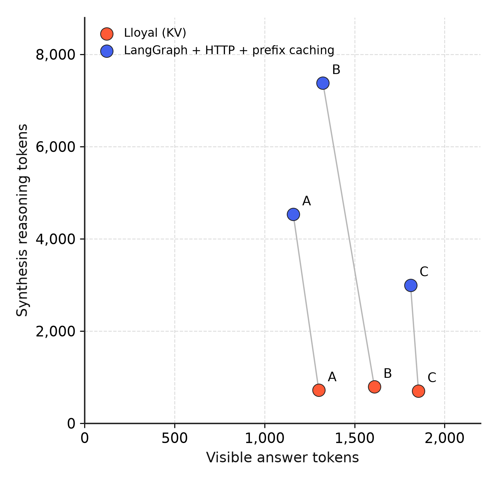
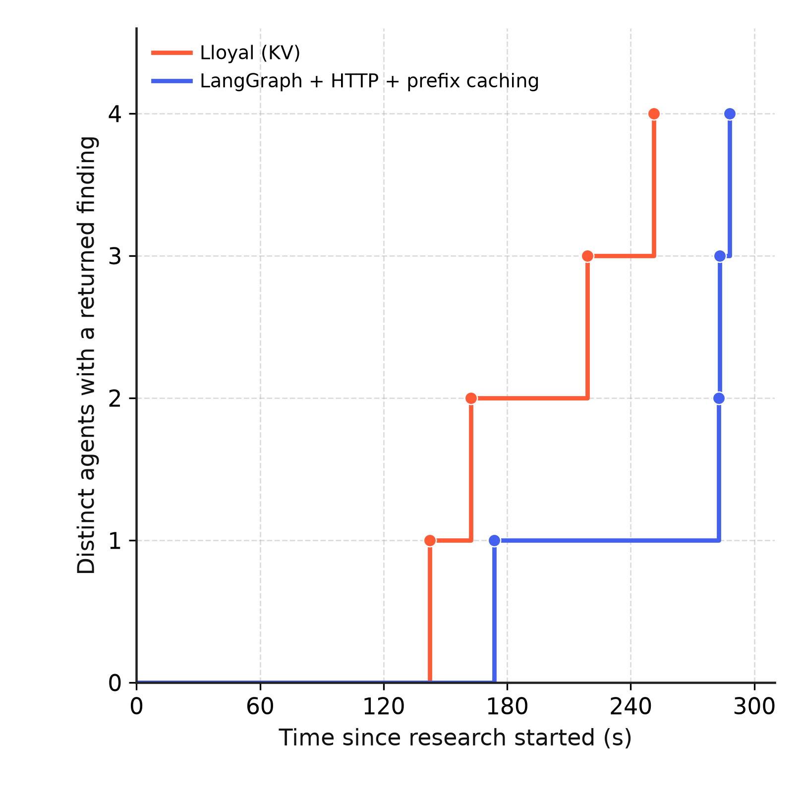
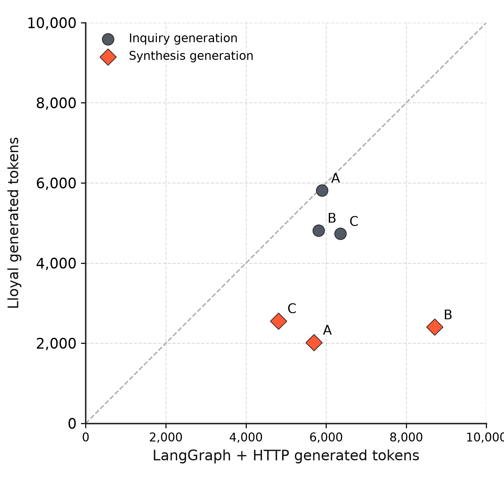

# Supplementary figures and return-time receipts

These figures reuse the six selected runs in [the measurement record](../data.json). No new inference runs were performed. The [featured presentation](preview.html) uses reasoning bars and a time-to-findings curve, with lower values indicating less reasoning or less elapsed time in both panels. The earlier scatter and cumulative-count designs remain here as supplementary views.

## Reasoning against answer length

Each point is one synthesis output; gray segments connect the two implementations within a selected comparison. Both axes use post-hoc counts from the same GGUF tokenizer. The lines identify pairs, with no fitted trend or implied trajectory between A, B and C.

This combines the reasoning and answer-length bars in one view. In revised comparison C, Lloyal produced 1,855 visible answer tokens with 698 reasoning tokens; LangGraph produced 1,811 visible answer tokens with 2,994 reasoning tokens. Output length does not establish answer quality, and the chart does not identify the cause of the reasoning difference.

## Findings over time

The clock starts at `research:start`. Each step is the first nonempty `agent:return` or `agent:recovered` received for a distinct agent. Duplicate recovery/return notifications count once. Values come from host journals, so they measure receipt rather than browser paint or scored usefulness. Different plans and evidence remain relevant limitations.

Revised comparison C is the latest pair and used fresh preflight on both paths; preflight is outside this chart's clock. All six journals were checked and their return events are included in [observations.json](observations.json).

| Comparison | Backend | First finding (s) | Second (s) | Third (s) | Fourth (s) |
|---|---|---:|---:|---:|---:|
| A | Lloyal | 100.5 | 240.1 | 280.8 | 343.6 |
| A | LangGraph + HTTP | 129.1 | 203.1 | 266.1 | 278.7 |
| B | Lloyal | 84.6 | 213.3 | 219.5 | 258.2 |
| B | LangGraph + HTTP | 218.9 | 286.1 | 318.8 | 330.6 |
| C | Lloyal | 142.5 | 162.4 | 218.8 | 251.2 |
| C | LangGraph + HTTP | 173.6 | 282.6 | 283.3 | 288.1 |

The shape exposes a user-visible property beyond total runtime: how progressively findings become available. C has three native findings by 218.8 seconds while the HTTP path has one. A shows why this must stay an observation of the selected runs: native starts returning sooner but takes longer to return the remaining findings.

## Generation by stage

The dashed diagonal denotes equal generated-token counts. Inquiry points lie closer to equality than synthesis points in each comparison. Inquiry generation is 1.5%, 17.1% and 25.5% lower on the native path; synthesis generation is 64.5%, 72.4% and 46.9% lower. These are recorded total generation counters, including reasoning and visible output, unlike the separate post-hoc reasoning counts above. They are not counts of private cognition.

This is useful as a supporting stage comparison. It shows that the largest proportional generation difference occurs in synthesis, while the differing stage inputs and unverified effective sampler parity prevent causal attribution to state ownership.

## Current selection

The README now pairs [reasoning bars](../assets/thinking-fast-and-slow.png) with [time to each finding](../assets/time-to-findings-C.png). The second plot transposes the recorded milestones: x is the number of distinct agents with a finding, y is elapsed time to that milestone. It uses the same events as the step plot above. Both featured panels retain zero-based cost axes and annotate measured gaps. The scatter plots remain supplementary. No regression, smoothing, confidence intervals or scaling trends are estimated from these three selected comparisons.

The HTTP backend had prefix caching enabled in all plots. The additional shared-prefix synthesis control remains unmeasured. The [full methods](../METHODS.md) describe evolved conditions, byte-identical synthesis system instructions, differing full inputs and sampler uncertainty.

## Reproduction

With Matplotlib installed, run `python build.py` in this directory to rebuild from the bundled observations. To re-read raw logs, pass `--benchmark /path/to/lloyal-bench --evidence /path/to/cumulative-evidence.json`. The script verifies all six journal hashes and deduplicates agent returns before plotting. The baseline dataset is unchanged.
