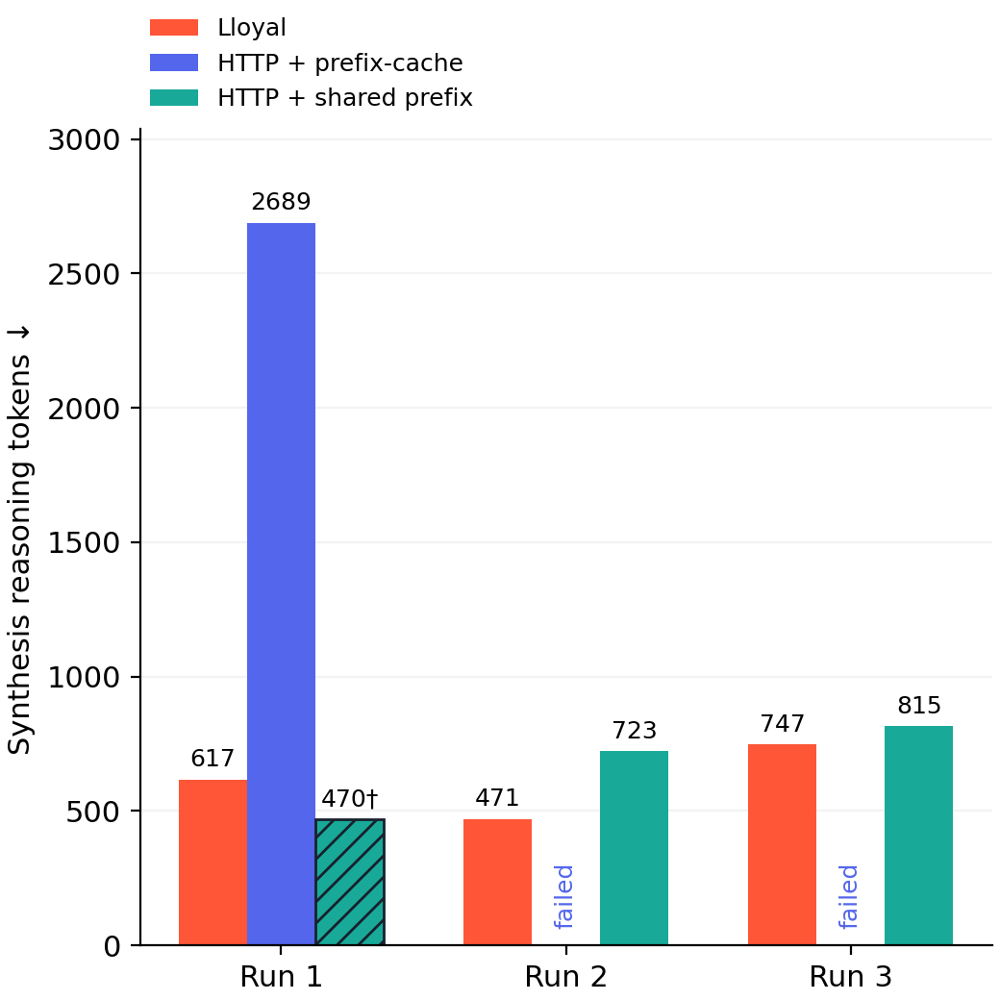
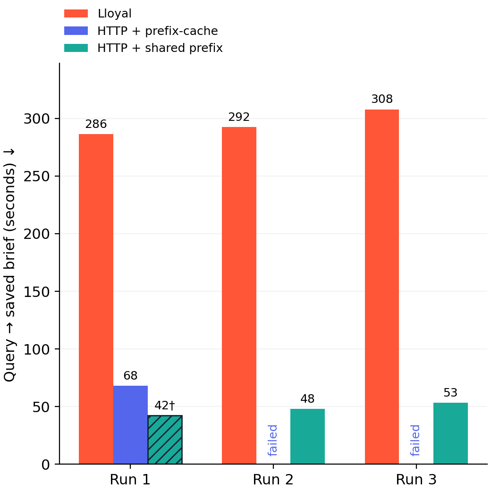

# Full Fieldnote reasoning experiment — NVIDIA L40S

Nine planned attempts, three execution paths, one synthetic decision task. All attempts and pilots are retained. The runtime source was frozen before measured execution; no failed attempt was replaced.

**In both rounds where shared-prefix HTTP produced a substantive report, Lloyal used fewer synthesis reasoning tokens and scored higher on the frozen rubric.** Round 2 used 471 versus 723 reasoning tokens (34.9% fewer), with scores of 12 versus 8 out of 18. Round 3 used 747 versus 815 (8.3% fewer), with scores of 15 versus 12. In round 1, shared-prefix HTTP saved only a tool-call block after 470 reasoning tokens; Lloyal produced a report after 617 tokens, scoring 16/18.

**Interpretation correction, 10 October 2026:** the earlier lead said the reasoning advantage “did not persist.” That conclusion was too broad: low counts on lower-quality outputs do not establish that an advantage disappeared at comparable quality. The smaller raw-count gaps and the quality differences must be reported together. The observations, scores and raw archive are unchanged.

[Read the complete answers side by side](answers.html), including original Markdown, unchanged rubric evidence, the ordinary HTTP arm and separate follow-ups. [All original answer packets](review/) are also available directly.

Ordinary HTTP completed one brief with 2,689 reasoning tokens. Its other two syntheses consumed the remaining context while reasoning and produced no saved brief. These failed generations are not used to inflate a reduction claim. Lloyal's sole completed comparison with ordinary HTTP had 77.1% fewer synthesis reasoning tokens, with task-order and generated-evidence differences still present.

## Recorded outcomes

| Round | Lloyal resident context | Ordinary HTTP, prefix-cache enabled | Shared-prefix HTTP, prefix-cache enabled |
|---|---|---|---|
| 1 | **617** reasoning tokens · 901 words · rubric 16/18 | **2,689** · 482 words · 13/18 | **470†** · tool-call-only output · 0/18 |
| 2 | **471** · 841 words · 12/18 | **Failed**: 29,061 reasoning tokens, no brief | **723** · 756 words · 8/18 |
| 3 | **747** · 727 words · 15/18 | **Failed**: 28,857 reasoning tokens, no brief | **815** · 823 words · 12/18 |

Rubric scores are an implementing-assistant review of anonymous answer packets, not an independent evaluation or proof of quality equivalence. All substantive reports contain errors or omissions. Follow-up answers correctly returned the three core requested facts, but they do not repair an initial report's score.

<table><tr><td width="50%"></td><td width="50%"></td></tr></table>

† The hatched bar records a UI-completed output containing only a literal `read_file` tool-call block. It is not a successful report. Missing ordinary HTTP bars are failures, not zero work. Their actual reasoning counts remain in the table and raw receipts.

UI journey completion was 3/3 Lloyal, 1/3 ordinary HTTP and 3/3 shared-prefix HTTP. Substantive initial reports were 3/3, 1/3 and 2/3 respectively. No substantive report achieved all rubric criteria. The driver deliberately preserves these separate judgments rather than calling every `complete` event a quality pass.

Elapsed time favored the HTTP paths in this configuration: Lloyal's initial briefs took 286.3 / 292.4 / 307.9 seconds; ordinary HTTP's completed brief took 67.9 seconds; shared-prefix outputs took 42.2† / 48.0 / 53.3 seconds. Native runs used `LLOYAL_DEV=1` with tracing. These are observed application times including orchestration, tools, reranking and instrumentation, not isolated GPU decoding measurements. The experiment does not establish why the timing difference occurred.

## Full workload

Every arm used the same pinned Fieldnote web UI, driven through ordinary browser actions by Playwright:

1. Start a fresh host/session and source coverage; choose Survey, Standard effort.
2. Enable Markdown corpus and documents, disable live web; upload the original two-page Harbor PDF and site-map image.
3. Submit the original Harbor selection question with four explicit routing objectives, as in the prior CUDA composed workload.
4. Run source preflight and planning. Review/edit inquiry descriptions through the UI, retaining the planner's ability routing.
5. Execute three corpus inquiries and one document inquiry, including retrieval, reranking, visual inspection and recovery when triggered.
6. Synthesize, save the brief, then ask the original follow-up through the same UI.

The original question asks which Harbor water system to select, comparing audited capacity, energy, cost, the corrected brochure claim and maintenance; it also requests a visual explanation of the routing figure and measured-versus-unknown distinctions. The exact augmented question, attachments, reviewed objectives and follow-up are retained in every raw run's `protocol.json`. This is the route-explicit CUDA workload, not a claim of byte-identical user input to the earlier Metal experiment.

The native arm uses the pinned Fieldnote orchestration and abilities. Its small generated patch applies explicit sampler settings through public `Branch.setSamplerParams` calls and offsets inquiry seeds. It does not rewrite native orchestration, prompts or evidence handling. The HTTP arms use the existing idiomatic LangGraph JS host behind the same UI. Neither introduces Lloyal branch APIs or a custom structured-concurrency implementation into LangGraph.

## What the shared-prefix control changes

The HTTP variant has a stable system header containing the current brief/catalog, followed by the original stage instruction text in the user turn. Adjacent text and images are grouped into that ordinary multimodal turn. Synthesis retains the research tool schema with stock `tool_choice: none`. There is no synthetic padding, hidden priming request, manual slot pinning or native state API.

This creates a naturally reusable prefix at the server's recurrent checkpoint boundary. All three measured syntheses recorded **1,788 actual prefix-cache tokens**, versus zero for ordinary HTTP synthesis. The textual rendered-prompt longest common prefix was 1,798 tokens; the server receipt, not that text overlap, establishes actual reuse.

| Round | Shared-prefix synthesis cache / total input | Shared-prefix workload cache fraction | Ordinary HTTP workload cache fraction |
|---|---:|---:|---:|
| 1 | 1,788 / 5,434 (32.9%) | 67.5% | 62.6% |
| 2 | 1,788 / 5,689 (31.4%) | 57.9% | 61.6% |
| 3 | 1,788 / 5,871 (30.5%) | 67.1% | 62.5% |

Both HTTP arms had `--cache-ram 1024`, `cache_prompt=true` on every request, and nonzero workload prefix-cache receipts. The ordinary arm was not a cache-disabled comparator.

The shared-prefix arm is a practical input-construction intervention. It changes instruction roles, message grouping and the synthesis tool header as well as enabling synthesis reuse. It is **not a pure prefix-cache on/off ablation**. Its tool-call-only failure also shows that retaining schemas can affect behavior even with `tool_choice: none`.

## Setup and verified controls

| Control | Configuration / evidence |
|---|---|
| Infrastructure | One NVIDIA L40S, 46,068 MiB reported VRAM, driver 565.57.01; Linux x86-64, Node v24.6.0 |
| Models | Qwen3.5-4B GGUF, its multimodal projector, Qwen3 reranker 0.6B Q8; identical SHA-256 identities in all nine runs |
| Runtime | Pinned llama.cpp revision `d6d0ce8215a1c324e8de04b52f9dd65c5edc129f`; instrumented native and server builds from the CUDA memory setup |
| Context / concurrency | 32,768 context; four HTTP slots with `--kv-unified`; eight native branches; actual workflow has four inquiries |
| Main-model KV format | q4_0 for K and V on both paths, verified in native and HTTP context receipts |
| Runtime configuration differences | Native/HTTP main-model batch 512/2048, microbatch 512/512. Native reranker uses q8_0 KV with ten sequence slots; HTTP reranker uses f16 KV with one slot. These existing application configurations were retained; numerical ranking parity is not established |
| Sampling | Temperature 0.5, planner 0.3; top-k 40, top-p 0.95, min-p 0.05, typical-p 1; repeat penalty 1, frequency/presence 0, last-N 64 |
| Seeds | Round offsets 4100 / 4200 / 4300; planner +100, inquiry +1000+index, synthesis +3000; preflight child seeds fixed at 2000+index by the pinned coverage API |
| Synthesis output cap | No explicit synthesis token cap. The legacy memory-package `maxOutputTokens` field does not cap this settling path; context/output failures are retained |
| Execution order | Random initial permutation, rotated each round: resident/shared/http, shared/http/resident, http/resident/shared |
| Model residency | Stacks ran sequentially; post-hoc tokenizer loaded only after all measured stacks stopped; GPU process list empty after analysis |
| Prompt instruction text | Identical synthesis stage instruction SHA-256: `e0720d13f5455ecb1fcd380871ef22bcfd1a34aaf6c70c5d6f14bc52380618b9` |
| Source freeze | Host-source snapshots match execution commit `0225ffc747c467f4d5225c75d383b96c34833a82`; generated native patch hashes also match |

Native and ordinary HTTP synthesis system instructions are byte-identical. The shared-prefix variant preserves that instruction text but puts it in a user message; its system message is different. Full prompts, multimodal ancestry and generated findings are not byte-identical across arms. Numeric sampler/seed settings also do not guarantee identical random-number streams across native continuing agents and separate HTTP requests.

The first native planner ordered maintenance before the document inquiry; every other plan ordered documents before maintenance. All nine reviewed task **sets** match, but ordered task arrays do not. Because inquiry seeds follow task index, round 1 has a seed-to-objective assignment difference. This is disclosed in [controls.json](controls.json), not repaired or replaced after observing results.

See [controls.json](controls.json), [execution-source-checks.json](execution-source-checks.json), [frozen run order](suite.json), [protocol](protocol.json) and [hardware receipt](hardware.csv). Configured native artifact hashes are supplemented by actual loaded-addon/library receipts in the raw archive, including the CUDA backend.

## Counting and quality

Reasoning counts come from native `agent:turn.rawOutput` and HTTP SSE `reasoning_content`, then the **same GGUF `/tokenize` endpoint** with `add_special=false` and `parse_special=false`. Whitespace is retained, explicit thinking delimiters excluded, and mirrored trace events deduplicated. Native counts plus final-answer counts differ from generation receipts by two boundary tokens; completed HTTP counts differ by three. These are emitted-text counts, not total internal computation.

The primary reasoning endpoint is initial synthesis. Per-stage counters, tools, recoveries and reranking are also retained. Native preflight recovery reasoning cannot be fully reconstructed from the existing trace, so its total is **unavailable**, with known completed-turn counts recorded separately. It is not treated as zero. Follow-up measurements and answers are separate.

The [nine-criterion rubric](quality-rubric.json) was frozen before the measured runs. Seven completed outputs were shuffled into anonymous packets and assessed before opening the arm mapping or token/timing results. The implementing assistant is not an independent reviewer; style or citation patterns could reveal the implementation. [Original pre-unmasking scores](quality-review-blinded.json), [annotated review](quality-review.json), [mapping and scores by run](quality-by-run.json), and the [answer packets](review/) are retained. No rubric score changed after unmasking. The post-unmasking annotation only distinguishes the already-identified tool-call-only output from a substantive report.

Lloyal's rubric scores were higher than the corresponding shared-prefix scores in each round, but that does not establish quality equivalence or a general quality advantage. Native reports still contained grant, maintenance or energy-efficiency errors, and one omitted the requested visual explanation. The shared-prefix substantive reports omitted the financial/visual package or reversed the maintenance comparison. Citation problems occurred across all paths.

The two failed ordinary HTTP syntheses have `finish_reason: length`: 3,707 input + 29,061 generated positions and 3,911 input + 28,857 generated positions each reach 32,768. No final answer was saved. These are context-exhaustion outcomes, not arbitrarily truncated successful reports.

## Interpretation

The joint observation favors Lloyal: in both substantive shared-prefix comparisons, it used fewer reasoning tokens and scored higher on the existing rubric. In round 2, Lloyal included the operating-cost ledger, installation requirements and grant discussion missing from shared-prefix HTTP; both reports omitted the visual explanation and contained other errors. In round 3, Lloyal included the requested visual route explanation and stated the maintenance intervals correctly, while shared-prefix HTTP omitted the route and reversed the maintenance comparison. Lloyal still made an energy-efficiency error and invented a connection to unrelated lighting data.

Shared-prefix HTTP also reached reasoning counts in the hundreds. The observed token reductions of 34.9% and 8.3% are smaller than the historical 76.7–89.3% range, but unequal answer quality prevents interpreting this as the advantage disappearing at comparable quality. Nor do these runs establish how many tokens shared-prefix HTTP would need to reach Lloyal's rubric scores. No quality-matched efficiency estimate or general mechanism follows from these observations.

Three repetitions of one synthetic task are exploratory. The native Survey spine receives inquiry findings as text; it does not merge every inquiry's private reasoning state. Different evidence, prompt roles, tool headers, planner order, sampling-state continuity and instrumentation remain relevant. A fixed-evidence synthesis experiment with controlled prompt roles and explicit cache-state interventions is still needed for causal attribution. Historical Metal observations are [kept separately](../../observations-2026-10-09/README.md).

## Verify or rerun

The [experiment instructions](../../README.md) run the same full UI workload on the prepared CUDA environment. To reproduce the analysis without another generation run, download and extract the [raw evidence archive](https://github.com/lloyal-ai/experiments/releases/tag/reasoning-cuda-fieldnote-v1) into `experiments/reasoning`, then run the analysis scripts using the same GGUF tokenizer. [Raw archive manifest](raw-evidence.json) records its checksum and contents.

Each measured run includes exact HTTP request bodies, rendered prompt/token records and SSE where applicable; native traces and loaded-library identities; sampler receipts; source snapshots; original attachment receipts; browser WebSocket journals; answers/screenshots; driver status; and full raw-log-derived metrics. All three pilots are included, including the first shared-prefix layout that completed but recorded zero synthesis prefix-cache hits. No weights or installed dependencies are bundled in the evidence archive.

[Machine-readable measurements](summary.json) · [HTML report](index.html) · [Full answers side by side](answers.html) · [Comparison source](../../scripts/compare-answers.mjs) · [Chart source](../../scripts/report.py) · [Raw-log analysis](../../scripts/analyze.py)
